# Football Stats

A simple iPhone app for tracking U13 kids' football matches from the sideline. Built with SwiftUI for iOS 18+.

## About this project

Designed by Pradeep Kulatunga and built entirely with [Claude Code](https://claude.com/claude-code)
from Markdown specs: the design notes in this repo (`LIVE_SCREEN_PRINCIPLES.md`,
`PRESSURE_INDEX.md`, `BACKBURNER.md`, `SUMMARY_CHANGELOG.md`) and `CLAUDE.md`, the standing
brief Claude Code reads at the start of every session. I use it at every game, across four
leagues: two futsal and two outdoor.

**In use (as at 24 September 2026):** 34 matches, 28,000 events and 24 hours of play logged in
11 weeks, at 19.5 taps a minute — one every three seconds, for whole matches.

**Under the hood:**

- **One-thumb live capture** built for the sideline, plus a Control Center control and an
  Action Button shortcut that record possession changes without touching the screen
  (WidgetKit, App Intents).
- **A pressure index:** a time-decayed momentum score over passes, interceptions, shots and
  set pieces — see `PRESSURE_INDEX.md`.
- **A ranked, rule-based observations engine** that writes plain-English standout moments and
  coaching observations, with thresholds that differ for futsal and outdoor games.
- **A versioned backup format,** so every generation of recorded matches still replays
  correctly after the data model changes.
- About 10,500 lines of Swift and 1,500 lines of Markdown specs and design notes, with no
  third-party dependencies.

The app isn't on the App Store.

## Screenshots

Every team, player and score in these images is fictional; none of it is real match data.

### The shareable image

The point of the Summary tab is the **Copy image** button on each card: one tap puts a clean
image on the clipboard, ready to paste into WhatsApp. These are real outputs of that button
(always on white, whatever theme the phone is in). The Pressure Index card is the headline: the
score, possession, a time-decayed pressure chart with credited scorers, and the Goal Map, for an
outdoor match on grass and a futsal match on the court.

<table>
<tr>
<td align="center">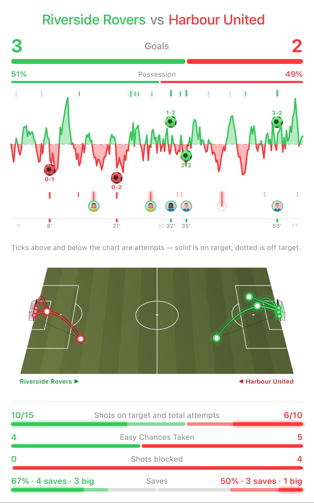<br><sub>Outdoor match</sub></td>
<td align="center">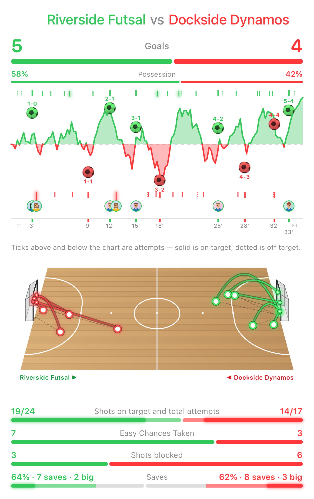<br><sub>Futsal match</sub></td>
</tr>
</table>

The other cards copy the same way, as text or as an image:

<table>
<tr>
<td align="center">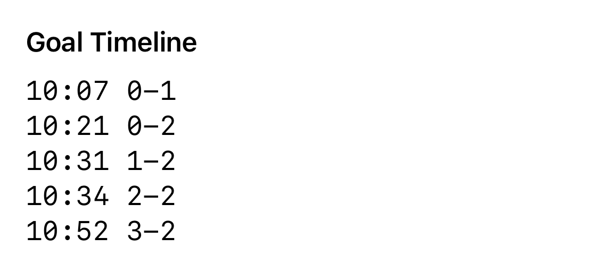</td>
<td align="center">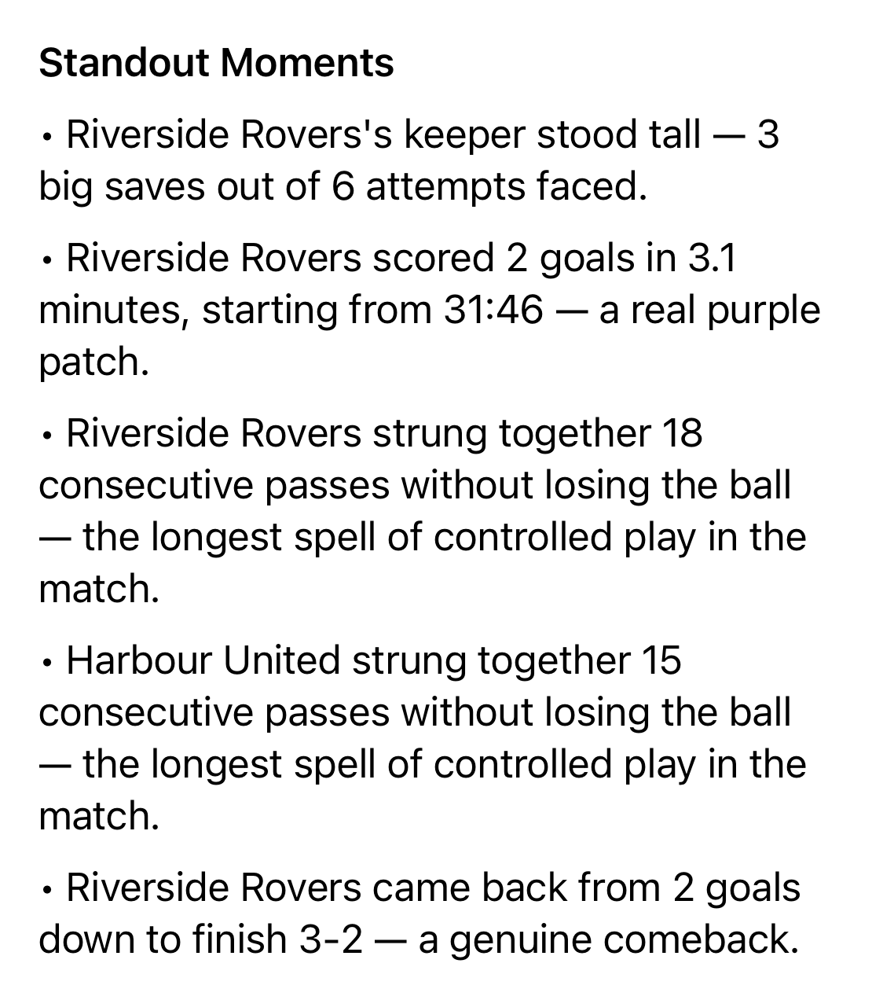</td>
<td align="center">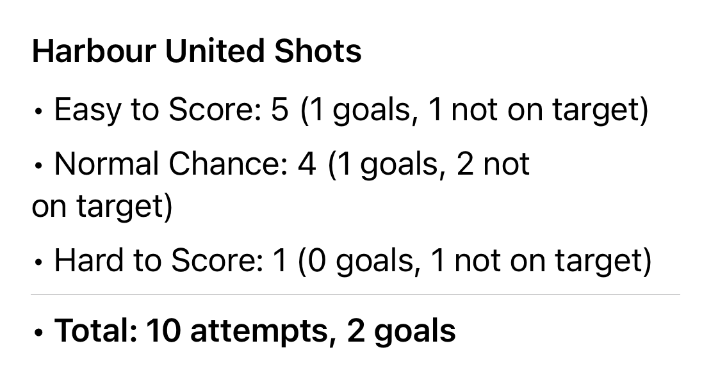</td>
</tr>
</table>

### In the app

Dark mode, on an iPhone.

<table>
<tr>
<td align="center">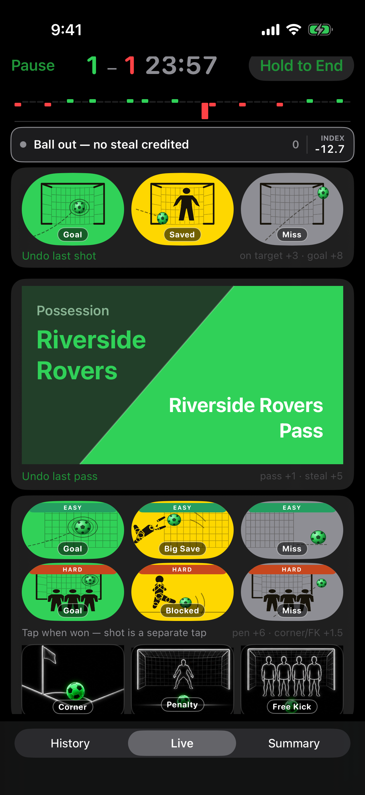<br><sub>Live capture</sub></td>
<td align="center">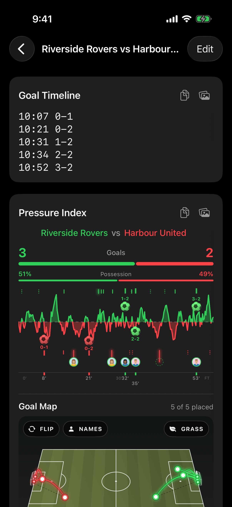<br><sub>Summary</sub></td>
<td align="center">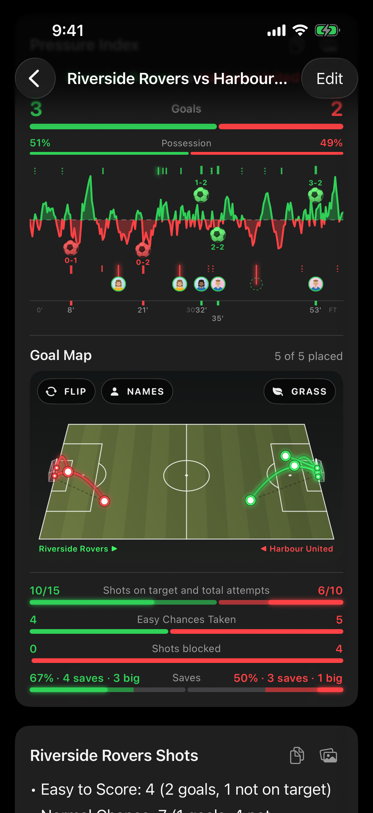<br><sub>Goal Map</sub></td>
</tr>
<tr>
<td align="center">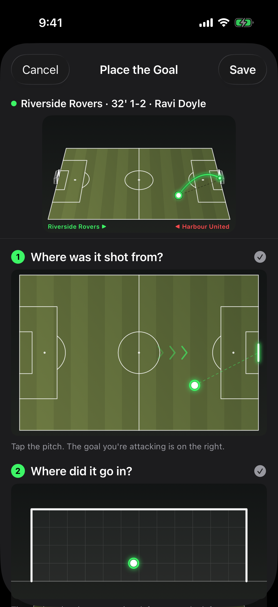<br><sub>Placing a goal</sub></td>
<td align="center">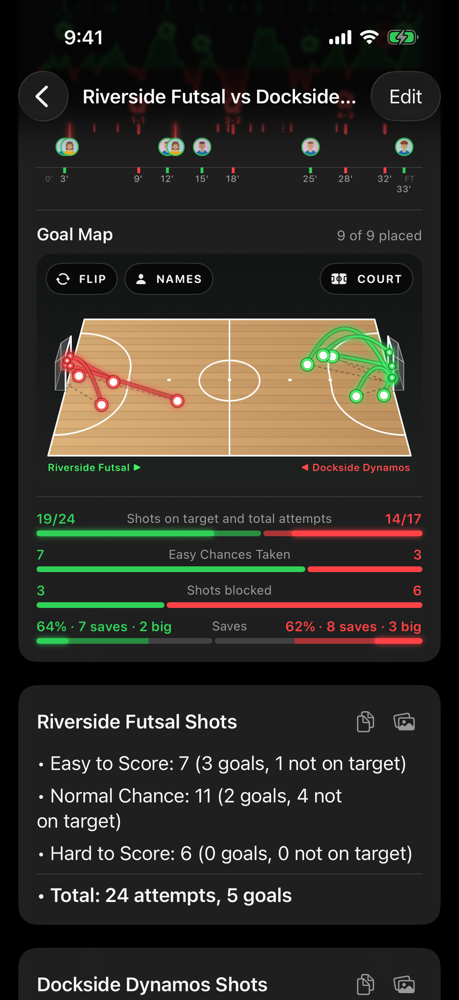<br><sub>Futsal court</sub></td>
<td align="center">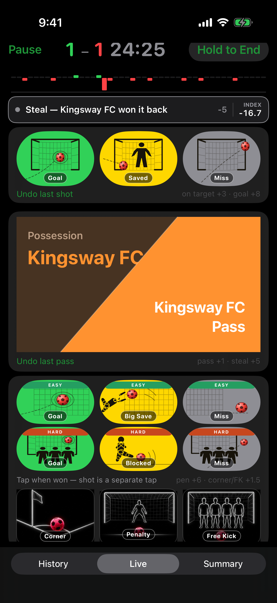<br><sub>Opposition in possession</sub></td>
</tr>
<tr>
<td align="center">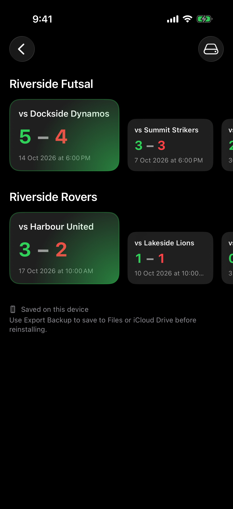<br><sub>History</sub></td>
<td align="center">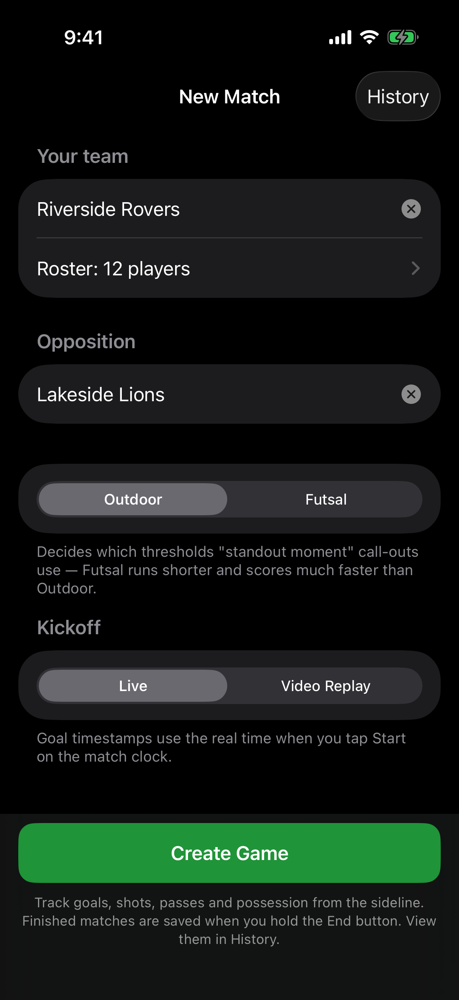<br><sub>New match</sub></td>
<td align="center">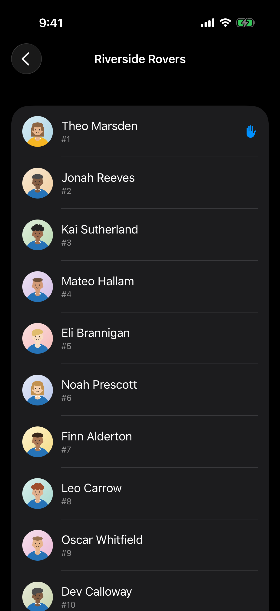<br><sub>Roster</sub></td>
</tr>
</table>

## What it tracks

- **Goal timeline** — timestamps like `11:37 1-5` (based on kickoff time you set)
- **Shots** — Easy / Normal / Hard, each with Goal, On Target, or Miss
- **Set pieces** — Corner / Penalty / Free Kick setup taps, tracked separately from shot outcomes (a later Easy/Normal/Hard attempt is how conversion shows up)
- **Defended vs Saved** — an on-target Hard attempt is a defender's foot block; Normal/Easy on-target attempts are the keeper's saves, so blocks and saves don't get mixed together
- **Passes & possession** — tap buttons as play unfolds; a short "Intercept" window opens right after a possession change so a same-team pass just after it counts as a steal in the pressure index
- **Pressure index** — a running plus/minus score from passes, steals, shots, and set pieces, shown live as a mini chart and in full in the Summary tab (see `PRESSURE_INDEX.md` for exactly how it's calculated)
- **Match history** — past matches are saved automatically, browsable by home team, editable, and exportable/importable as a backup file (Files / iCloud Drive)
- **Hands-free possession changes** — a Control Center control and an Action Button-assignable Shortcut both record "possession changed" without unlocking the phone or touching the screen
- **Player credit** — set up your own team's roster (photo, name, jersey number, optional initials) from New Match, then credit goals and big saves to a player — immediately on the Live tab, or any time afterward from the Summary tab's pressure chart; a player with no photo shows their initials instead, everywhere a face would otherwise appear
- **Standout moments** — keeper performances, goal bursts, long pass streaks, and comebacks get called out automatically on the Summary tab, with separate thresholds for Outdoor vs Futsal games (Futsal runs shorter and scores much faster)
- **WhatsApp export** — one tap shares a summary image (score, pressure chart, possession, shot comparisons, credited faces) plus a short text of standout moments and match observations

## Get it on your iPhone

### Option A: Run from Xcode (free, no App Store)

1. Open `FootballStats.xcodeproj` in Xcode on your Mac.
2. Connect your iPhone with USB (or use wireless debugging).
3. Select your iPhone as the run destination.
4. In **Signing & Capabilities**, choose your Apple ID team (free Personal Team works).
5. Press **Run** (⌘R). Builds a Release (optimized, production-quality) build by default —
   see below — and installs it on your phone for 7 days; re-run from Xcode to refresh.

Alternatively, `./run-on-device.sh` builds and installs straight to a named device without
opening Xcode; it also defaults to Release. Pass `--debug` (either from Xcode's scheme editor
or `./run-on-device.sh --debug`) only when you actually need a debug build — e.g. attaching
the debugger or stepping through code — since Release is what should normally end up on the
phone used for real matches.

### Option B: TestFlight / App Store

Requires an Apple Developer account ($99/year). Build an archive in Xcode and distribute via TestFlight for a longer-lived install without plugging in.

## How to use during a match

1. **New Match** — pick one of your preset team names or type a custom one (defaults to "Z" so it's fast to overwrite), name the opposition, choose **Outdoor** or **Futsal** format (pre-selected for your known teams), and choose **Live** or **Video Replay** kickoff timing. A "Set up roster" / "Roster: N players" link sits under your team name — add players (photo, name, jersey number, optional initials) there; it's entirely optional, a team with no roster plays exactly as before.
2. Three tabs are available throughout: **History**, **Live**, **Summary**.
3. **Live tab**
   - **Start** the clock when the ref blows for kickoff.
   - **Normal chance** is the default shot row — biggest and closest to the score, since it's what you'll tap most.
   - **Pass / Intercept** — tap your team's pass as they keep the ball; a possession change (tap, Control Center, or Action Button) opens a short "Intercept" window, shown by a colour fade and a depleting bar, during which a same-team pass counts as a steal.
   - **Reasoning lane** — the strip under the pressure mini chart narrates what the index just decided ("Steal — Z won it back", "Corner won — +1.5 now"), so you don't have to guess why the number moved. Tap it to open the full last-two-minutes ledger, with an undo on every row.
   - **Easy / Hard** rows are graded departures from Normal, each with its own coloured banner.
   - **Set pieces** — Corner / Penalty / Free Kick capture taps, separate from shot outcomes.
   - **Player credit** — if your team has a roster set up, scoring a goal or making a big save (Easy row, on target, while defending) pops up a picker to credit a player, with a "Do Later" option that costs nothing.
   - **Undo last shot** / **Undo last pass** sit right under each section.
   - **Hold to End** finishes the match and saves it to History — a one-second press-and-hold,
     not a tap, so a mis-reach for Pause/Start next to it can't end a match by accident. The
     button fills as you hold; releasing early cancels.
4. **History tab** — browse past matches grouped by home team (each card gets a quiet
   green/red corner glow for a win or loss, neutral for a draw), edit a saved match, or use
   **Export Backup** / **Import Backup** to move match data (and team rosters, including
   player photos) via Files or iCloud Drive.
5. **Summary tab** — review the goal timeline, pressure index chart, standout moments, per-team shot breakdown, and observations (each individually copyable), then tap **Copy / Share for WhatsApp** to send the summary image and text together. Along the bottom of the pressure chart, every home goal and big save gets a slot — a face once credited, an empty ring you can tap to credit it (or change who's credited) any time.

## What gets shared

The WhatsApp share sends a **summary image** (score, pressure/possession chart, shot comparison bars) plus a short **observations** text, generated from the match data — not a plain text stat dump. A sample observation line:

```
When your team got Easy or Normal shots on target, most went in — but 4 attempts were off
target. Improving accuracy on those chances could add more goals without needing better
chances.
```

## Documentation

- `LIVE_GUIDE.md` — quick user reference for the Live tab's controls.
- `PRESSURE_INDEX.md` — how the pressure index (and inferred steals) are actually calculated.
- `LIVE_SCREEN_PRINCIPLES.md` — design principles for the Live tab: colour language, row/column layout, sizing.
- `SUMMARY_CHANGELOG.md` — dated log of every change to what the Summary tab shows or calculates.
- `BACKBURNER.md` — in-progress and deferred feature plans.

## Project structure

```
FootballStats/
├── FootballStatsApp.swift
├── ContentView.swift
├── AppShortcuts.swift
├── Models/
│   ├── MatchModels.swift
│   ├── PressureEngine.swift
│   ├── PressureExplain.swift
│   ├── RosterModels.swift
│   ├── MatchComparisonEngine.swift
│   ├── MatchObservationEngine.swift
│   └── StandoutMomentEngine.swift
├── Services/
│   ├── HapticFeedback.swift
│   ├── MatchHistoryStore.swift
│   ├── MatchHistoryBackup.swift
│   └── RosterStore.swift
├── ViewModels/MatchViewModel.swift
└── Views/
    ├── MatchSetupView.swift
    ├── LiveMatchView.swift
    ├── PressureLaneView.swift / PressureLedgerView.swift / PressureNarration.swift
    ├── RosterEditorView.swift / PlayerEditorView.swift / PlayerCreditPickerView.swift
    ├── SummaryView.swift
    ├── MatchHistoryView.swift
    ├── MatchHistoryEditView.swift
    ├── PossessionChartView.swift
    ├── ShotOutcomeIcons.swift / ShotTileIcons.swift
    ├── SetPieceIcons.swift / SetPieceArtIcons.swift
    ├── NeonKit.swift / NeonShotIcons.swift / NeonSetPieceIcons.swift
    └── IconGalleryView.swift

Shared/                        # App Group code used by both the app and the widget
├── ActiveMatchStore.swift
├── ActiveMatchCrossProcessNotifier.swift
├── MatchEventProcessor.swift
├── MatchIntents.swift
├── PressureMiniChartView.swift
├── ClipboardImageExport.swift
└── TeamDisplayNames.swift

FootballStatsWidget/           # Control Center control for hands-free possession changes
├── FootballStatsWidgetBundle.swift
└── MatchControls.swift
```

## Possible next steps

See `BACKBURNER.md` for feature work that's already planned but not yet picked up.

## Licence

© 2026 Pradeep Kulatunga. All rights reserved. The code is shared for viewing; no licence to
reuse, modify or redistribute it is granted.
